# UML Class Diagram & Architecture Design

This document details the object-oriented architecture of the **Personal Expense Tracker** project, illustrating inheritance hierarchies, interface implementations, and architectural relationships.

---

## 1. Mermaid UML Class Diagram

```mermaid
classDiagram
    %% Inheritance: User Hierarchy
    class User {
        <<abstract>>
        -String username
        -String password
        -String fullName
        -String createdAt
        +User(username, password, fullName, createdAt)
        +User(username, password, fullName)
        +getUsername() String
        +setUsername(String) void
        +getPassword() String
        +setPassword(String) void
        +getFullName() String
        +setFullName(String) void
        +getCreatedAt() String
        +setCreatedAt(String) void
        +getRole()* String
        +displayUserTypeInfo()* void
        +toString() String
    }

    class RegularUser {
        +RegularUser(username, password, fullName, createdAt)
        +RegularUser(username, password, fullName)
        +getRole() String
        +displayUserTypeInfo() void
        +toString() String
    }

    class Admin {
        +Admin(username, password, fullName, createdAt)
        +Admin(username, password, fullName)
        +getRole() String
        +displayUserTypeInfo() void
        +toString() String
    }

    User <|-- RegularUser : extends
    User <|-- Admin : extends

    %% Inheritance: Category Hierarchy
    class Category {
        <<abstract>>
        #String name
        #String description
        +List~String~ PREDEFINED_CATEGORIES$
        +Category(name, description)
        +getName() String
        +getDescription() String
        +getCategoryType()* String
        +fromName(String)$ Category
        +toString() String
    }

    class FoodCategory {
        +FoodCategory()
        +getCategoryType() String
    }
    class TransportationCategory {
        +TransportationCategory()
        +getCategoryType() String
    }
    class EducationCategory {
        +EducationCategory()
        +getCategoryType() String
    }
    class ShoppingCategory {
        +ShoppingCategory()
        +getCategoryType() String
    }
    class EntertainmentCategory {
        +EntertainmentCategory()
        +getCategoryType() String
    }
    class HealthcareCategory {
        +HealthcareCategory()
        +getCategoryType() String
    }
    class BillsUtilitiesCategory {
        +BillsUtilitiesCategory()
        +getCategoryType() String
    }
    class OthersCategory {
        +OthersCategory()
        +getCategoryType() String
    }

    Category <|-- FoodCategory
    Category <|-- TransportationCategory
    Category <|-- EducationCategory
    Category <|-- ShoppingCategory
    Category <|-- EntertainmentCategory
    Category <|-- HealthcareCategory
    Category <|-- BillsUtilitiesCategory
    Category <|-- OthersCategory

    %% Entity Models
    class Expense {
        -int id
        -String username
        -String title
        -double amount
        -String category
        -String date
        -String paymentMethod
        -String description
        +List~String~ PAYMENT_METHODS$
        +Expense(id, username, title, amount, category, date, paymentMethod)
        +Expense(id, username, title, amount, category, date, paymentMethod, description)
        +getId() int
        +getUsername() String
        +getTitle() String
        +getAmount() double
        +getCategory() String
        +getDate() String
        +getPaymentMethod() String
        +getDescription() String
        +getMonthYear() String
        +toString() String
    }

    class Budget {
        -String username
        -String monthYear
        -double amount
        +Budget(username, monthYear, amount)
        +getUsername() String
        +getMonthYear() String
        +getAmount() double
        +setAmount(double) void
        +toString() String
    }

    %% Interfaces and Polymorphic Implementations
    class Storage~T~ {
        <<interface>>
        +saveAll(List~T~ items) void
        +loadAll() List~T~
    }

    class UserFileStorage {
        -File file
        +saveAll(List~User~) void
        +loadAll() List~User~
    }
    class ExpenseFileStorage {
        -File file
        +saveAll(List~Expense~) void
        +loadAll() List~Expense~
    }
    class BudgetFileStorage {
        -File file
        +saveAll(List~Budget~) void
        +loadAll() List~Budget~
    }

    Storage <|.. UserFileStorage : implements
    Storage <|.. ExpenseFileStorage : implements
    Storage <|.. BudgetFileStorage : implements

    class Reportable {
        <<interface>>
        +generateReport() void
        +getReportTitle() String
    }

    class MonthlyReport {
        -String targetUser
        -String monthYear
        -List~Expense~ expenses
        +generateReport() void
        +getReportTitle() String
    }

    class CategoryWiseReport {
        -String targetUser
        -List~Expense~ expenses
        +generateReport() void
        +getReportTitle() String
    }

    class UserSummaryReport {
        -String username
        -List~Expense~ userExpenses
        -Budget currentBudget
        +generateReport() void
        +getReportTitle() String
    }

    Reportable <|.. MonthlyReport : implements
    Reportable <|.. CategoryWiseReport : implements
    Reportable <|.. UserSummaryReport : implements

    %% Services
    class AuthService {
        -Storage~User~ userStorage
        -Map~String, User~ userCache
        +register(username, password, fullName) User
        +login(username, password) User
        +getAllUsers() List~User~
        +getTotalUsersCount() int
    }

    class ExpenseService {
        -Storage~Expense~ expenseStorage
        -List~Expense~ expenses
        -int nextId
        +addExpense(username, title, amount, category, date, paymentMethod) Expense
        +addExpense(username, title, amount, category, date, paymentMethod, desc) Expense
        +updateExpense(id, username, title, amount, category, date, paymentMethod, desc) Expense
        +deleteExpense(id, username) boolean
        +getUserExpenses(username) List~Expense~
        +filterByCategory(list, category) List~Expense~
        +getTotalExpenses(username) double
        +getTotalExpensesAllUsers() double
        +getHighestExpense(list) Expense
        +getLowestExpense(list) Expense
        +sortExpensesByDate(list, ascending) List~Expense~
        +sortExpensesByAmount(list, descending) List~Expense~
    }

    class BudgetService {
        -Storage~Budget~ budgetStorage
        -List~Budget~ budgets
        +setBudget(username, monthYear, amount) Budget
        +getBudget(username, monthYear) Budget
        +getBudgetStatusSummary(username, monthYear, totalSpent) String
        +getAllBudgets() List~Budget~
    }

    class ReportService {
        -ExpenseService expenseService
        -BudgetService budgetService
        +printReport(Reportable) void
        +generateUserMonthlySummary(username, monthYear) void
        +generateUserCategorySummary(username) void
        +generateAdminMonthlyReport(monthYear) void
        +generateAdminCategoryReport() void
    }

    class AutoSaveDaemon {
        -ExpenseService expenseService
        -BudgetService budgetService
        -int intervalSeconds
        -boolean running
        +run() void
        +stopDaemon() void
    }

    %% Service Associations
    AuthService --> Storage : uses
    ExpenseService --> Storage : uses
    BudgetService --> Storage : uses
    ReportService --> ExpenseService : coordinates
    ReportService --> BudgetService : coordinates
    ReportService ..> Reportable : polymorphic call
    AutoSaveDaemon --> ExpenseService : background sync
    AutoSaveDaemon --> BudgetService : background sync
```



---

## 2. Text-Based UML Architectural Mapping

```
+-----------------------------------------------------------------------------------------+
|                                    APPLICATION LAYER                                    |
|                                                                                         |
|      [Main (Scanner Console Menu)]           [GuiMain / PersonalExpenseTrackerGUI]      |
|             (CLI Interaction)                         (Swing JFrame Window)             |
+-----------------------------------------------------------------------------------------+
                                      |
                                      v
+-----------------------------------------------------------------------------------------+
|                                      SERVICE LAYER                                      |
|                                                                                         |
|   +-------------------+    +--------------------+    +-----------------------------+    |
|   |    AuthService    |    |   ExpenseService   |    |        BudgetService        |    |
|   +-------------------+    +--------------------+    +-----------------------------+    |
|             |                       |                               |                   |
|             +-----------------------+-------------------------------+                   |
|                                     |                                                   |
|                        +-------------------------+                                      |
|                        |      ReportService      |                                      |
|                        |  (Reportable Interface) |                                      |
|                        +-------------------------+                                      |
|                                     |                                                   |
|                +--------------------+--------------------+                              |
|                v                    v                    v                              |
|         [MonthlyReport]    [CategoryWiseReport]  [UserSummaryReport]                    |
+-----------------------------------------------------------------------------------------+
                                      |
                                      v
+-----------------------------------------------------------------------------------------+
|                                       MODEL LAYER                                       |
|                                                                                         |
|       <<abstract>> User                  <<abstract>> Category                          |
|         ├── RegularUser                    ├── FoodCategory, TransportationCategory...  |
|         └── Admin                          └── ShoppingCategory, HealthcareCategory...  |
|                                                                                         |
|       [Expense] (id, title, amount, category, date, paymentMethod, description)         |
|       [Budget]  (username, monthYear, amount)                                           |
+-----------------------------------------------------------------------------------------+
                                      |
                                      v
+-----------------------------------------------------------------------------------------+
|                               STORAGE / PERSISTENCE LAYER                               |
|                                                                                         |
|                              <<interface>> Storage<T>                                   |
|         +---------------------------+---------------------------+                       |
|         |                           |                           |                       |
|  [UserFileStorage]          [ExpenseFileStorage]         [BudgetFileStorage]            |
|         |                           |                           |                       |
|  "data/users.csv"           "data/expenses.csv"          "data/budgets.csv"             |
+-----------------------------------------------------------------------------------------+
```

---

## 3. Package Structure & Inter-Package Dependencies

- **`model` Package:** Defines data transfer and domain entities. Has no dependencies on service, storage, or UI packages (High Independence).
- **`exception` Package:** Contains custom checked exceptions extending `java.lang.Exception`. Independent of all other packages.
- **`storage` Package:** Implements `Storage<T>` using `java.io` file readers and writers. Depends only on `model` and `java.io`.
- **`util` Package:** Provides static validation (`Validator`) and safe console reading (`InputHelper`). Depends only on `model` and `exception`.
- **`service` Package:** Encapsulates business logic, domain rules, calculation of budgets, and polymorphic reporting. Depends on `model`, `storage`, `exception`, and `util`.
- **`ui` Package:** Desktop Graphical User Interface (`PersonalExpenseTrackerGUI` extending `javax.swing.JFrame`). Depends only on `service`, `model`, and `util`.
- **`main` Package:** Entry points (`Main` and `GuiMain`). Instantiates service layers and manages execution lifecycle.
